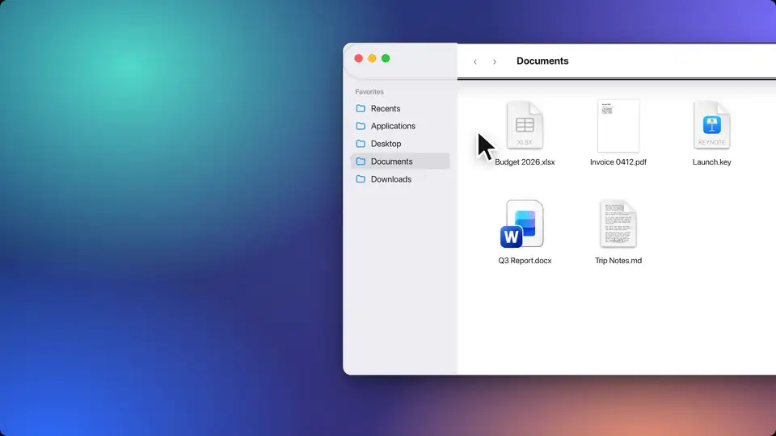

<p align="center">
  <picture>
    <source media="(prefers-color-scheme: dark)" srcset="docs/media/hero-dark.svg">
    
  </picture>
</p>

<p align="center">
  <a href="https://github.com/Mrabbi3/Easie/releases/latest"></a>
  <a href="https://github.com/Mrabbi3/Easie/releases"></a>
  <a href="https://github.com/Mrabbi3/Easie/actions/workflows/ci.yml"></a>
  <a href="LICENSE"></a>
  
  
  
</p>

<p align="center">
  <b>Convert any file into any format, right from Finder.</b><br>
  Free, open source, no ads, no account, and fully offline.
</p>

<p align="center">
  <a href="https://github.com/Mrabbi3/Easie/releases/latest/download/Easie.dmg"><b>⬇ Download Easie for Mac</b></a>
  &nbsp;·&nbsp;
  <a href="https://mrabbi3.github.io/Easie/">Website</a>
  &nbsp;·&nbsp;
  <a href="#build-from-source">Build from source</a>
</p>

<p align="center">
  
</p>

Right-click a file in Finder → **Edit with Easie**. The file pops up with every format it can become arranged
around it. Click one and it's done: the new file appears next to the original, and nothing is ever overwritten.
Click elsewhere or press Esc to close the popup.

## Contents

- [Features](#features)
- [What converts to what](#what-converts-to-what)
- [Install](#install)
- [Use it](#use-it)
- [How it works](#how-it-works)
- [Privacy and safety](#privacy-and-safety)
- [Build from source](#build-from-source)
- [Customize it](#customize-it)
- [Project layout](#project-layout)
- [Contributing](#contributing)
- [License and credits](#license-and-credits)

## Features

- **One right-click.** Works from Finder's own menu, on one file, many files, or a whole folder.
- **23 formats.** Word, PDF, Excel, PowerPoint, Pages, Keynote, Numbers, images, Markdown, CSV and JSON.
- **Offline by design.** No server, no upload, no network access at all.
- **Never overwrites.** Every conversion writes a new file next to the original.
- **Quick.** After the first use the popup opens in about 0.2 s. The whole app is a 2 MB download.
- **Universal.** Apple Silicon and Intel, macOS 13 Ventura or later.
- **No dependencies.** Built only on Apple's frameworks: no packages, no bundled libraries.

## What converts to what

<p align="center"></p>

| From | To |
| --- | --- |
| Word (DOCX, DOC), ODT, RTF, HTML, TXT, Markdown | PDF, DOCX, DOC, ODT, RTF, HTML, TXT, MD, Pages, JSON, PNG, JPG |
| Pages | PDF, DOCX, DOC, ODT, RTF, HTML, TXT, MD, JSON, PNG, JPG |
| PowerPoint (PPTX) | PDF, Keynote, PNG, JPG (one per slide), and the slide text as DOCX, TXT, MD, JSON, HTML, RTF, ODT |
| Keynote | PDF, PPTX, PNG, JPG, and the slide text as DOCX, TXT, MD, JSON, HTML, RTF |
| Excel (XLSX), Numbers | CSV, TSV, JSON, PDF, DOCX, HTML, MD, TXT, and each other (every sheet is kept) |
| CSV, TSV, JSON | XLSX, Numbers, CSV, TSV, JSON, PDF, DOCX, HTML, MD, TXT |
| PDF | DOCX, ODT, RTF, HTML, TXT, MD, JSON, PNG, JPG, TIFF, HEIC (scanned PDFs are read with OCR) |
| PNG, JPG, HEIC, TIFF, GIF, BMP, WebP | Any of those image formats, PDF, and TXT / DOCX / JSON via text recognition (OCR) |

`Easie formats` prints the exact list on your Mac (HEIC and WebP output depend on the Mac's built-in encoders).

## Install

1. [Download Easie.dmg](https://github.com/Mrabbi3/Easie/releases/latest/download/Easie.dmg), open it and drag Easie to Applications.
2. Open Easie once. macOS may say it can't be opened, because Easie isn't notarized by Apple yet.
   Open **System Settings → Privacy & Security**, scroll to the message about Easie and click **Open Anyway**.
3. In the small setup window, leave **Right-click menu** on. If you use Pages, Keynote or Numbers,
   click **Allow…** so Easie can convert their files.

To check your download, compare its checksum with the one on the [download page](https://mrabbi3.github.io/Easie/#download-final):

```bash
shasum -a 256 ~/Downloads/Easie.dmg
```

## Use it

- **Finder:** right-click any file → **Edit with Easie**. It's at the bottom of the menu, or under
  **Quick Actions** / **Services** when you have many extensions.
- **Setup window:** open Easie itself to turn the right-click menu on or off, allow Pages/Keynote/Numbers,
  or drop a file to try it.
- **Command line:**

  ```bash
  /Applications/Easie.app/Contents/MacOS/Easie convert report.docx notes.md --to pdf --out ~/Desktop
  /Applications/Easie.app/Contents/MacOS/Easie formats
  ```

Easie has no Dock icon while you use it from Finder. After the first use it stays quietly in the background
(about 30 MB), so the popup appears instantly. **Quit Easie** in the setup window stops it; it starts again on
the next right-click. To remove it, quit it and drag it from Applications to the Trash.

## How it works

- **Built-in frameworks** handle most formats: AppKit's text system for documents, PDFKit, ImageIO, and Vision for OCR.
- **Excel and PowerPoint** files are read directly (they're ZIP files of XML), so they need no Office install.
  Easie reads every sheet of a workbook, including real dates, and each slide's title, bullet points, tables and
  speaker notes. It also writes `.xlsx`.
- **Pages, Keynote and Numbers** keep their formats private, so Easie asks those (free) apps to open and export
  the file. This also gives pixel-perfect PDFs and images of PowerPoint decks. The apps open briefly in the
  background; Easie closes any it had to start and never closes documents you already had open.
  Without Keynote, PowerPoint → PDF still works, but it lays out the slide text instead of the slide design.

## Privacy and safety

- Easie never connects to the internet. Web pages are cleaned before conversion (`SafeHTML.swift`), so
  scripts, tracking pixels, remote fonts and references to other files on the Mac are dropped.
- Conversions only ever write new files; an existing name gets " (1)", " (2)"…
- Hostile files are refused rather than crashing: ZIP parts over 512 MB, images decode at most 16,384 px,
  JSON nests at most 512 levels.
- Temporary files from Pages/Keynote/Numbers exports go to a private temp folder that is deleted afterwards.
- Diagnostics are debug-level only (not stored by macOS) and never include file contents.

Found a security problem? Please report it privately, as described in [SECURITY.md](SECURITY.md).

## Build from source

Only the Xcode **Command Line Tools** are needed (full Xcode is optional).

```bash
git clone https://github.com/Mrabbi3/Easie.git && cd Easie
scripts/install.sh        # build, copy to /Applications, register the right-click menu
scripts/smoke-test.sh     # convert sample files through every path
scripts/security-test.sh  # hostile files: tracking web page, zip bomb, nested JSON, overwrite check
scripts/make-dmg.sh       # build/Easie.dmg
```

Builds are universal (Apple Silicon + Intel). For a faster local build use `ARCHS=arm64 scripts/build.sh`.

### Signing and notarizing your own build

To ship a build that opens without the "unidentified developer" warning:

1. Join the Apple Developer Program and create a **Developer ID Application** certificate.
2. Build signed: `SIGN_ID="Developer ID Application: Your Name (TEAMID)" scripts/build.sh && scripts/make-dmg.sh`
   (this signs with `Resources/Easie.entitlements`, which allows controlling Pages/Keynote/Numbers).
3. Notarize: `xcrun notarytool submit build/Easie.dmg --apple-id you@example.com --team-id TEAMID --wait`,
   then `xcrun stapler staple build/Easie.dmg`.

## Customize it

Easie is small on purpose, so most changes touch one file.

| To change… | Edit |
| --- | --- |
| Which formats exist and what each converts to | `Sources/EasieCore/Format.swift` (`targets`, `hint`, `group`) |
| How a conversion is done | `Sources/EasieCore/ConversionEngine.swift` |
| Format colours and icons in the popup | `Sources/Easie/FormatStyle.swift` (`tint`, `symbol`) |
| The popup's size, ring and animation | `Sources/Easie/RadialMenu.swift` (`radius(for:)`, `centerSize`, the springs) |
| The setup window | `Sources/Easie/SetupView.swift` |
| The right-click menu title | `Resources/Info.plist` (`NSServices` → `NSMenuItem`) and `ServiceMenu` in `SystemIntegration.swift` |
| The app icon | `scripts/IconRenderer.swift` (delete `build/AppIcon.icns` to redraw it) |
| Limits for hostile files | the size and depth constants in `Zip.swift`, `ConversionEngine.swift` and `JSON.swift` |
| The download page | `site/index.html` (built by `scripts/build-site.sh`, deployed by `.github/workflows/pages.yml`) |

Adding a format usually means: a new `case` in `Format`, its `targets`, a reader and/or writer in the engine,
a `tint` and `symbol`, and a line in `scripts/smoke-test.sh`. If you fork Easie to ship your own app, change
`CFBundleIdentifier` in `Resources/Info.plist` (and the `serviceKey` in `SystemIntegration.swift`) so it
doesn't clash with Easie on the same Mac.

The README's hero is drawn by [`docs/media/make-hero.py`](docs/media/make-hero.py), and the launch video,
demo clips and voiceover are rebuilt by the kit in [`marketing/launch-video`](marketing/launch-video/README.md).

## Project layout

```
Sources/EasieCore/   conversion engine (no UI)
  Format.swift            formats and what each converts to
  ConversionEngine.swift  load → convert → write, PDF layout, rendering, OCR
  AppleApps.swift         Pages / Keynote / Numbers bridge (AppleScript)
  XLSX.swift              Excel reader and writer
  PPTX.swift              PowerPoint text reader, slide renderings
  Zip.swift, XMLNode.swift  ZIP and XML plumbing for Office files
  SafeHTML.swift          strips anything a web page could use to reach the network
  Tables.swift            CSV/TSV and table ↔ JSON
  JSON.swift              order-preserving JSON parser/writer
  Markdown.swift          Markdown ↔ rich text
Sources/Easie/       the Mac app
  AppDelegate.swift       launch flow, Finder service, menus
  RadialMenu.swift        the right-click popup and its animation
  ConversionSession.swift what one right-click is converting
  FormatStyle.swift       file-style format icons
  SetupView.swift         setup window (switch, permissions, try it)
  SystemIntegration.swift right-click on/off, Automation permission
  CLI.swift               `Easie convert …`
Resources/           Info.plist (bundle, "Open With", Finder service) and entitlements
scripts/             build, install, DMG, icon, site, smoke and security tests
site/                the download page (https://mrabbi3.github.io/Easie/)
docs/media/          README hero, demo clips
marketing/           launch video kit
```

## Roadmap

- PDF → PowerPoint (one slide per page) and images → PowerPoint
- High-fidelity Word → PDF through Pages, as an option (keeps headers, footers and images)
- Merge several images or PDFs into one PDF; split a PDF into pages
- Compress PDFs and resize images
- A top-level Finder menu with a submenu of formats (Finder Sync extension; needs full Xcode)
- Settings: output folder, image quality, page size
- Auto-updates with Sparkle

Ideas and votes are welcome in [Issues](https://github.com/Mrabbi3/Easie/issues).

## Contributing

Bug reports, format requests and pull requests are all welcome. Start with [CONTRIBUTING.md](CONTRIBUTING.md);
everyone taking part agrees to the [Code of Conduct](CODE_OF_CONDUCT.md).

## License and credits

Easie is released under the [MIT License](LICENSE). © 2026 MD Rabbi.

Designed and developed by [MD Rabbi](https://github.com/Mrabbi3). The app uses only Apple's system frameworks;
the tools and fonts used around it (website, video kit, CI) and their licenses are listed in
[THIRD_PARTY_NOTICES.md](THIRD_PARTY_NOTICES.md).

Apple, Mac, macOS, Finder, Pages, Keynote and Numbers are trademarks of Apple Inc. Microsoft, Word, Excel and
PowerPoint are trademarks of Microsoft Corporation. Easie is an independent project and is not affiliated with
or endorsed by Apple or Microsoft.
